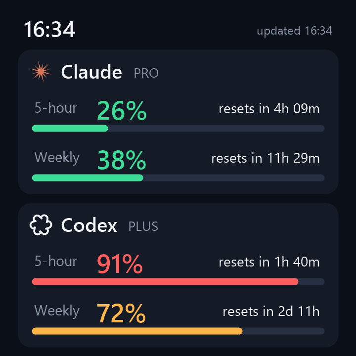

# sama-lcd-ai-usage

**[中文](#中文) | [English](#english)**

<p align="center"></p>

---

## 中文

把 **先马（SAMA）一体水冷冷头的 LCD 屏幕**变成 AI 用量面板，实时显示 **Claude Code** 和 **OpenAI Codex** 的 5 小时 / 每周用量和重置倒计时。两个 logo 会以 15 fps 流畅转动。

不需要先马的官方软件，只用 Windows 自带的 PowerShell 和 .NET，没有任何第三方依赖。

### 功能

- **Claude**（Pro / Max）和 **Codex**（ChatGPT Plus / Pro）的 5 小时窗口、每周窗口用量百分比
- 每项都显示距离重置还剩多久
- 颜色提示：绿色低于 60%，橙色 60–85%，红色 85% 及以上
- 动画 logo：只把变化的像素用增量帧发给屏幕，占用约为单核 CPU 的 15%
- 开机自动启动（计划任务，不需要管理员权限）；断线自动重连，进程意外退出后 5 分钟内自动拉起
- 支持 0 / 90 / 180 / 270 度旋转，适配冷头的安装方向

### 兼容硬件

| 已测试 | 说明 |
|---|---|
| 先马 4 英寸方形 LCD 冷头（720×720） | USB 串口 `VID_1D6B&PID_A040`，固件 `chs_4inch.dev1_rom1.91` |

其他基于图灵智显（Turing / TURZX）方案的先马屏幕（XW / ZW / MW / KW 系列）可能也能用，但没有测试过，分辨率可能不同。欢迎提交 issue 反馈。

### 环境要求

- Windows 10 / 11，Windows PowerShell 5.1（系统自带）
- **Claude**：安装 [Claude Code](https://docs.claude.com/claude-code) 命令行，并运行一次 `claude auth login`（会生成 `~/.claude/.credentials.json`）
- **Codex**：登录过 Codex 命令行或 Codex 桌面应用（会生成 `~/.codex/auth.json`）
- **先马官方软件必须退出**，并关闭它的开机自启。它会独占屏幕的串口。

### 安装

```powershell
git clone https://github.com/infern0x/sama-lcd-ai-usage.git
cd sama-lcd-ai-usage
powershell -ExecutionPolicy Bypass -File install.ps1
```

冷头是倒着装的，就加上 `-Rotate 180`（也可以用 `90` 或 `270`）：

```powershell
powershell -ExecutionPolicy Bypass -File install.ps1 -Rotate 180
```

安装脚本会做两件事：
- 把程序复制到 `%LOCALAPPDATA%\Programs\sama-lcd-ai-usage`
- 注册一个登录时启动的计划任务 `sama-lcd-ai-usage`

日志在同一目录下的 `sama-lcd-ai-usage.log`。

### 参数

| 参数 | 默认值 | 作用 |
|---|---|---|
| `-Rotate` | `0` | 画面旋转角度：0 / 90 / 180 / 270 |
| `-Fps` | `15` | 动画帧率 |
| `-Port` | 自动 | 串口号，例如 `COM3`。默认按 USB ID 自动查找 |
| `-FetchSeconds` | `300` | 多久拉取一次用量（秒） |
| `-Demo -SavePng x.png` | | 用示例数据生成一张预览图，不需要屏幕 |

修改参数后重新运行 `install.ps1` 即可。

### 卸载

```powershell
powershell -ExecutionPolicy Bypass -File uninstall.ps1
```

卸载后打开先马官方软件，就能恢复原来的显示。

### 工作原理

- 用量数据来自本机已登录的凭据，只发往 Anthropic / OpenAI 的官方接口，不会发到其他地方。Claude 的登录令牌快过期时，会用 Claude Code 相同的流程自动续期。
- 屏幕协议是在分析先马软件的通信行为之后，自己重新实现的。详见 [PROTOCOL.md](PROTOCOL.md)。

### 免责声明

本项目是个人的非官方作品，与先马（SAMA）、图灵智显（TURZX）、Anthropic、OpenAI 均无关联。用到的用量接口没有公开文档，随时可能变化。logo 是简化的原创绘制，不是官方图标。使用风险自负。

---

## English

Turns the **LCD on a SAMA AIO liquid-cooler pump head** into a live AI usage panel. It shows **Claude Code** and **OpenAI Codex** 5-hour / weekly limits with reset countdowns, plus smoothly animated logos at 15 fps.

No vendor software is needed. It is plain Windows PowerShell + .NET with zero third-party dependencies.

### Features

- 5-hour and weekly usage for **Claude** (Pro / Max) and **Codex** (ChatGPT Plus / Pro)
- Time left until each limit resets
- Colour cues: green < 60 %, amber 60–85 %, red ≥ 85 %
- Animated logos sent as tiny delta frames (≈15 % of one CPU core)
- Starts at sign-in (Scheduled Task, no admin rights); reconnects automatically and is restarted within 5 minutes if it ever exits
- 0 / 90 / 180 / 270° rotation to match how the cooler is mounted

### Supported hardware

| Tested | Details |
|---|---|
| SAMA 4" square LCD pump head (720×720) | USB serial `VID_1D6B&PID_A040`, firmware `chs_4inch.dev1_rom1.91` |

Other SAMA screens built on the Turing/TURZX platform (XW / ZW / MW / KW series) may work but are untested and may use other resolutions. Reports are welcome.

### Requirements

- Windows 10 / 11 with Windows PowerShell 5.1 (built in)
- **Claude**: [Claude Code](https://docs.claude.com/claude-code) CLI, signed in once with `claude auth login` (creates `~/.claude/.credentials.json`)
- **Codex**: signed in to the Codex CLI or desktop app (creates `~/.codex/auth.json`)
- **Quit the SAMA app and disable its auto-start.** It locks the screen's serial port.

### Install

```powershell
git clone https://github.com/infern0x/sama-lcd-ai-usage.git
cd sama-lcd-ai-usage
powershell -ExecutionPolicy Bypass -File install.ps1
```

If the cooler is mounted upside down, add `-Rotate 180` (or `90` / `270`):

```powershell
powershell -ExecutionPolicy Bypass -File install.ps1 -Rotate 180
```

This copies the app to `%LOCALAPPDATA%\Programs\sama-lcd-ai-usage` and registers a Scheduled Task named `sama-lcd-ai-usage` that runs at sign-in. The log is `sama-lcd-ai-usage.log` in that folder.

### Options

| Option | Default | Purpose |
|---|---|---|
| `-Rotate` | `0` | 0 / 90 / 180 / 270 |
| `-Fps` | `15` | Animation frame rate |
| `-Port` | auto | Serial port such as `COM3`; auto-detected by USB ID |
| `-FetchSeconds` | `300` | How often usage is fetched |
| `-Demo -SavePng x.png` | | Render a preview with sample data; no screen needed |

To change options, run `install.ps1` again with the new values.

### Uninstall

```powershell
powershell -ExecutionPolicy Bypass -File uninstall.ps1
```

Then start the SAMA app again to get its original display back.

### How it works

- Usage comes from your existing local logins and is only sent to Anthropic's and OpenAI's own endpoints. When the Claude token is about to expire, it is refreshed using the same flow as Claude Code.
- The screen protocol was re-implemented independently after observing how the vendor app talks to the device. See [PROTOCOL.md](PROTOCOL.md).

### Disclaimer

This is an unofficial hobby project. It is not affiliated with SAMA, TURZX, Anthropic or OpenAI. The usage endpoints are undocumented and may change at any time. The logos are simplified original drawings, not official artwork. Use at your own risk.

## License

[MIT](LICENSE)
